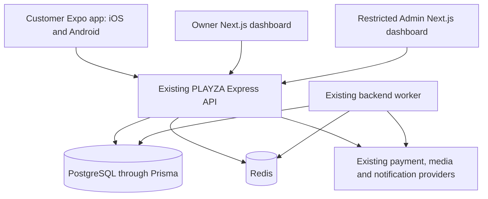

# PLAYZA application architecture

Status: accepted product architecture, 17 November 2026. This decision supersedes earlier plans that treated the Expo web export or embedded business/admin screens as the final owner/admin applications. It does not claim the two Next.js applications have been implemented or deployed.

## Application boundaries

| Application | Technology and audience | Responsibility | Current implementation |
|---|---|---|---|
| Customer | One React Native + Expo codebase and one application identity per environment for iOS and Android | Discovery, bookings, payments, profile and community | Existing connected Expo app; web export is a testing surface |
| Owner | Dedicated responsive Next.js web application | Venue, facility, resource, booking, availability, pricing, staff, revenue and analytics management | Planned; existing Expo business screens provide transitional access |
| Admin | Separate restricted Next.js web application | Owner verification, venue review and existing platform administration | Planned; existing Expo admin screens provide transitional access |
| API | Existing Node.js/Express PLAYZA API, `/api/v2` | Shared identity, authorization and all business operations | Existing PostgreSQL implementation alongside the retained legacy API |
| Worker | Existing backend worker process | Durable outbox delivery, expiry and provider reconciliation | Existing backend deployment unit |

There will be no separate owner mobile application initially. A future owner mode belongs in the existing customer Expo application and uses the same API, identities and permissions. Do not rebuild an embedded mobile owner experience during this documentation change.

Dashboard server-side transport is omitted from the diagram for clarity. It is an authenticated forwarding boundary, not another business backend.

## Shared identity and access

- `User` is the sole identity. `UserRole` supports multiple platform roles (`CUSTOMER`, `OWNER`, `ADMIN`, `SUPER_ADMIN`); approval adds OWNER without removing CUSTOMER or creating a second account.
- Email verification and owner/business verification are different. An authenticated customer can submit an owner application and view its status. Administrative approval grants the owner role. Pending/rejected applications do not grant venue-management access. Role provisioning stays in the existing API; no dashboard self-assignment or public admin registration.
- Platform roles control application entry/navigation; `VenueMember` controls access to each venue. OWNER, MANAGER and STAFF are venue memberships, not global staff roles. A staff member need not become a platform OWNER to access explicitly permitted work at their assigned venue.
- For a user with several roles, select a presentation context without replacing their identity or granting capabilities. Customer booking access remains available to approved owners. Admin privileges never follow automatically from owner status.
- The API remains the authority on every protected request and socket operation. Frontend navigation guards improve UX but cannot authorize actions. Query scopes must derive from the authenticated actor and active membership, never a client-supplied owner ID or selected venue alone.
- Current service rules grant OWNER/MANAGER venue-management operations and restrict staff assignment/removal to the venue OWNER. Do not infer that STAFF can manage bookings/check-in merely because that enum or a screen exists. Review the existing endpoint permission matrix and add denied/cross-venue tests before exposing each action in the new dashboards.
- Existing session revocation, blocked/deleted-user checks and rotating hashed refresh-token handling remain centralized. Each installation/dashboard maintains its own session. Shared identity does not imply automatic cross-domain SSO or globally shared cookies.

## Browser and mobile authentication boundary

Retain the existing mobile API client and native secure token storage. For the planned Next.js dashboards, use same-origin server-side auth/forwarding handlers that call the existing identity/API endpoints. Keep tokens in Secure, HttpOnly, host-only cookies; keep refresh credentials out of browser JavaScript/localStorage and out of URLs. Separate owner/admin cookie scopes and validate allowed origins/CSRF on cookie-authenticated mutations. API refresh rotation must be serialized per session to avoid replay races. Clear the relevant session and cached private data on logout/revocation.

These web transport/cookie/CSRF handlers are planned work, not currently verified code. They must forward the user's identity and backend 401/403 outcomes; do not use a shared admin token. No password verification, role grants, Prisma writes, booking engine or payment verification is implemented in Next.js. SSR/data caches must not leak personalized or venue-scoped responses between users. Secrets stay server-only; public configuration must contain no backend/provider secrets.

## Data and business ownership

All three applications consume the same API and PostgreSQL domain model. Only the backend API/worker/migration tooling accesses Prisma/PostgreSQL. Redis provides ephemeral infrastructure, not a separate source of booking or payment truth. Legacy MongoDB remains isolated until the documented reconciliation/cutover; the new dashboards must not integrate the legacy booking implementation.

Reuse the existing Venue → Facility → Resource model, availability/quote/reservation services, SQL overlap/capacity protection, payment/refund/webhook state machines, membership checks and outbox. API validation and concurrency guarantees apply equally to customer and owner-initiated actions. No client calculates an authoritative price, confirms a payment locally or implements another booking algorithm. Provider webhooks terminate at the existing API.

Revenue screens must distinguish booking value from captured payments, refunds and settlements. Current owner analytics groups booking count/total by status and currency; it is not verified settled revenue or owner payout accounting. Do not sum currencies or label that response as net revenue. Missing required dashboard contracts should be addressed in the existing API only after an endpoint-by-endpoint gap review.

## Existing implementation evidence and gaps

| Inspected source | Evidence | Boundary or remaining work |
|---|---|---|
| `prisma/schema.prisma`: User, UserRole, OwnerApplication, VenueMember | One identity, multiple roles, review state, unique venue/user membership | No new schema migration is required to accept this architecture |
| `src/features/identity/auth.service.ts` | Registration grants CUSTOMER; session/hashed refresh-token lifecycle | Browser dashboard session transport and role-aware UX are not built |
| `src/features/platform/platform.service.ts` | Admin-checked owner approval adds OWNER; venue creation requires OWNER; active scoped management checks | Review suspension/revocation policy and every route before dashboard release; do not infer full lifecycle support from VerificationStatus |
| `src/features/platform/staff.routes.ts` | Venue-owner-only staff management with verified active accounts | STAFF action matrix must be verified; enum presence is not completion |
| `src/features/platform/platform.routes.ts`, `management.routes.ts` | Scoped owner venue/resource operations, bookings, pricing and aggregate analytics | Dashboard UX and any missing revenue/read contracts remain planned |
| Expo `app/business/*`, `app/admin.tsx`, `app/admin/operations.tsx` | Existing business/admin clients of the shared API | Transitional compatibility screens; neither is a separate Next.js dashboard |
| Expo session/API/profile modules | Shared sign-in; role-driven admin navigation and existing business entry | Do not remove working routes or deep links in this change |

This is a code review for architecture alignment, not a new end-to-end verification of these flows. Earlier automated and provider evidence retains its documented scope. No Next.js package/project was found in the inspected workspace; directory names, API routes and schema enums alone are not completed application features.

## Source and deployment organization

Keep the existing backend and mobile repositories. When implementation is scheduled, create independently buildable owner-web and admin-web projects, each with its own configuration, origin, deployment and CI. Repository placement is an implementation choice; creating a monorepo or moving existing projects is not required by this decision. Share API contracts/client utilities where useful; do not couple native and web UI component trees or duplicate domain rules. Backend-owned OpenAPI/DTO contracts define compatibility.

Use independent staging/production deployments and exact API CORS allowlists. Proposed domain roles are customer deep links, owner dashboard, admin dashboard and API; actual domains/DNS/hosting are not provisioned by this document. Backend/API secrets, database credentials and provider secrets never enter dashboard public bundles or Expo public variables. API/worker/database deployment and backup ownership remain unchanged. Continue free/local-first development; this decision authorizes no paid hosting or automatic deploy.

## Delivery and compatibility sequence

1. Accept and publish this decision and the revised delivery plan. Preserve all current runtime paths, data, migrations, API contracts and release configuration.
2. Inventory existing owner/admin endpoint contracts against the requested dashboard operations. Record verified behavior, errors, pagination, role/membership checks, missing contracts and revenue semantics. Reuse backend implementation before adding anything.
3. Build the responsive owner Next.js project using the shared identity/API. Include pending/rejected owner status and venue-scoped staff navigation; test customer+owner accounts, direct URL access, revoked membership, role changes, logout and cross-venue denial.
4. Build the separate admin Next.js project with restricted access and the same API-backed authorization. Test unauthenticated/non-admin denial, direct route access and privileged mutations. Frontend hiding is insufficient.
5. Validate both dashboards on mobile and desktop, cookie/CSRF/session/cache isolation, contract compatibility and staging workflows. Backend regressions and booking concurrency/provider tests remain release gates.
6. Keep embedded Expo tools available until web parity and release validation are demonstrated. Transition entry points/deep links deliberately with a fallback; do not silently delete them or force existing users onto an unavailable dashboard.
7. Add owner mode to the existing Expo app later, only after dashboard/core release priorities and permission contracts are stable. Never start a separate owner iOS/Android application initially.

Acceptance of architecture is complete; implementation and release of the two Next.js dashboards remain open delivery work. Production readiness is not upgraded by a documentation commit.
